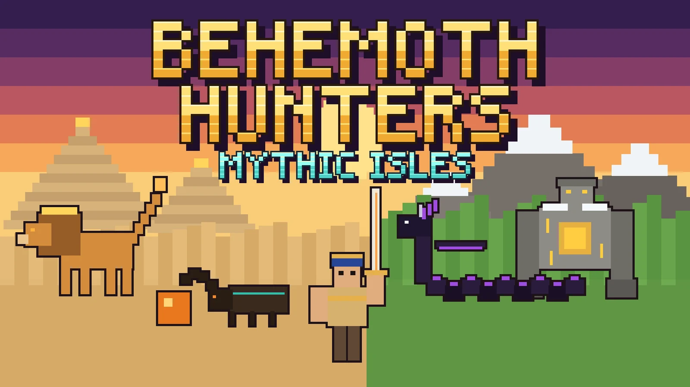
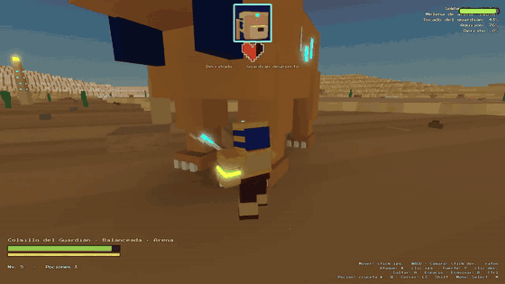
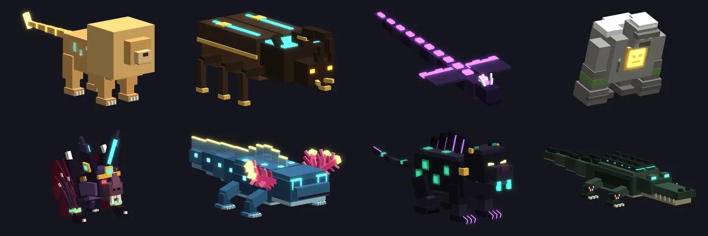
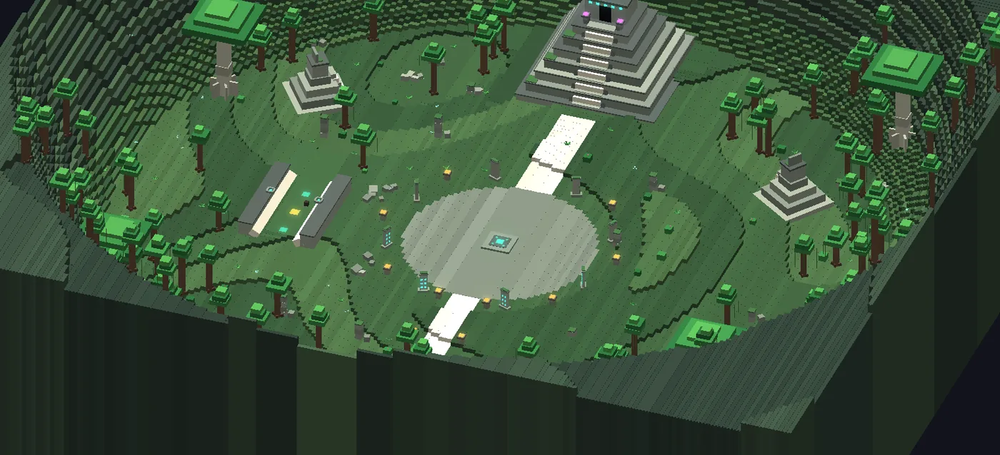
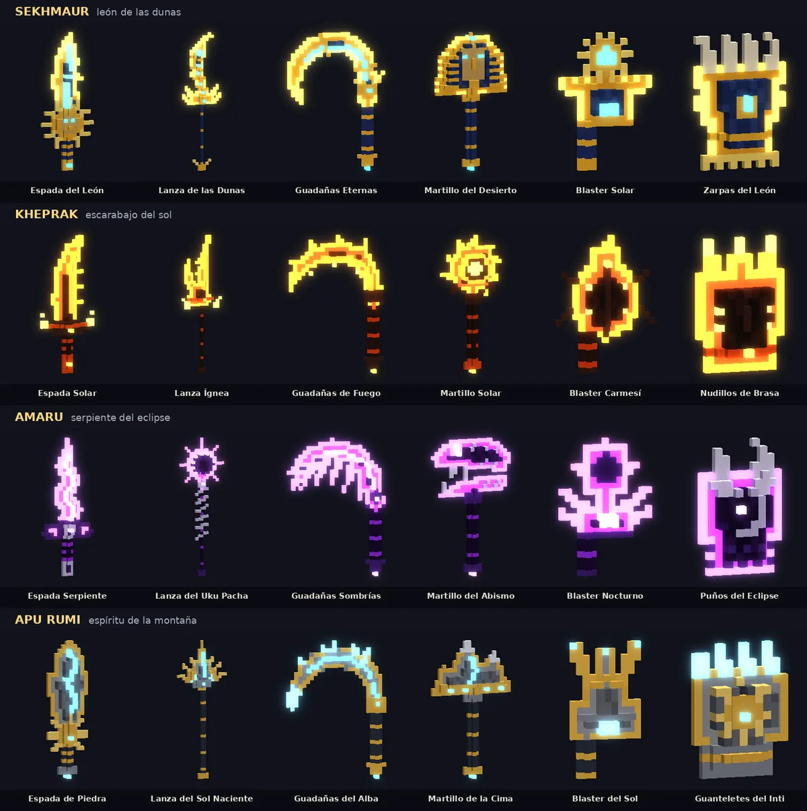
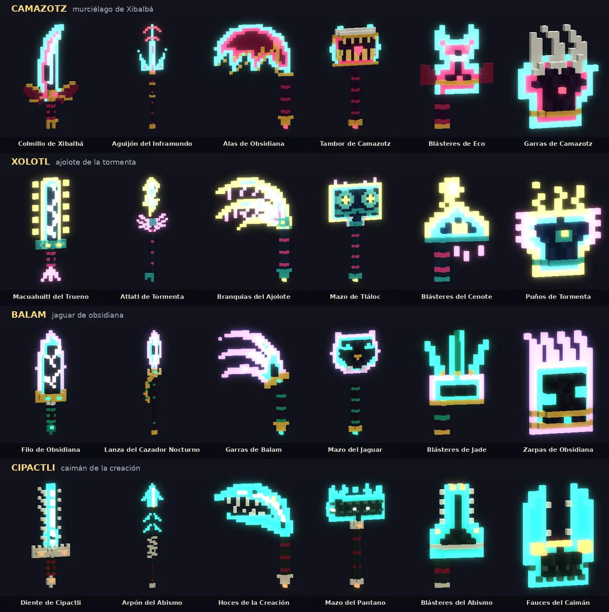
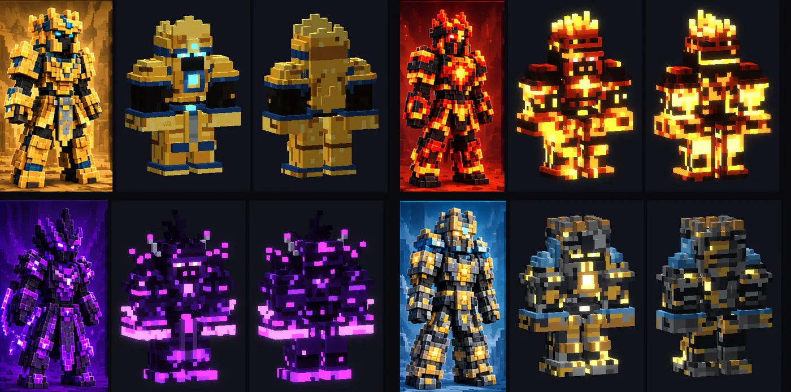

# Behemoth Hunters: Mythic Isles

A co-op monster-hunting game on Roblox, inspired by Dauntless and Monster Hunter. Up to four hunters track a giant Behemoth across a floating island, break its parts, survive its second phase and forge new weapons and armor from what they carve.

**[▶ Play on Roblox](https://www.roblox.com/games/130368892133377)** · Public alpha, 2026 · PC (keyboard and gamepad) and mobile





## The game in numbers

| | |
|---|---|
| **8 Behemoths** | each with its own AI, attack set, three breakable parts and a second phase |
| **8 floating islands** | plus a hub town, the Refugio de Qamar |
| **54 weapons** | 6 types (sword, spear, dual scythes, hammer, dual blasters, gauntlets); 48 have a unique design and power |
| **32 armor pieces** | 8 sets with 2-piece and 4-piece bonuses |
| **4 hunters per party** | online co-op, each party on its own private hunt server |
| **21 missions** | 14 story missions and 7 repeatable bounties |

## Core loop

1. **Form a party** in the hub (up to 4 hunters) and pick a Behemoth.
2. **Track it.** Each island has its own trail: vultures, fire furrows, thunder, bubbles in the swamp.
3. **Break its parts.** Breaking a part changes the fight: Camazotz can't fly without its wings, Xolotl can't call the storm without its gills, Cipactli's bites get weaker without its jaw.
4. **Survive phase 2.** Every Behemoth changes when pushed: an eclipse, a storm, camouflage.
5. **Carve and forge.** Parts become materials for that Behemoth's weapons and armor. There is no starter armor: your first set comes from your first hunt.

## Bestiary



| Behemoth | Title | Island | Element | Difficulty |
|---|---|---|---|---|
| Sekhmaur | Lion of the Dunes | Sea of Dunes | Sand | ★★ |
| Kheprak | Solar Roller | Ember Desert | Ember | ★★★ |
| Amaru | Winged Serpent | Caves of Uku Pacha | Shadow | ★★★★ |
| Apu Rumi | Mountain Guardian | Peaks of Inti | Sun | ★★★★ |
| Camazotz | Bat of Xibalbá | Temple of Xibalbá | Echo | ★★★★ |
| Xolotl | Storm Axolotl | Sacred Cenote | Storm | ★★★★ |
| Balam | Obsidian Jaguar | Obsidian Jungle | Obsidian | ★★★★★ |
| Cipactli | Caiman of Creation | Swamps of Aztlán | Abyss | ★★★★★ |

Each island draws on a different culture: Egyptian myth in the desert, Inca myth in the Andes and Maya and Aztec myth in the jungle.



## Armory

Every weapon has its own silhouette taken from its Behemoth (a scorpion-tail spear, a sphinx-head hammer, a bat-wing scythe, a Tláloc mask hammer) and its own power.




Armor sets were built from reference concept art (left of each pair) into in-game voxel armor (right):



## My role

This is my first game. I designed it and directed every part of it: the concept, the game loop and progression, the eight Behemoths and what each of their parts does, the weapon roster, the art direction and the reference boards, playtesting with an Xbox controller, balance, and publishing on Roblox.

The code was written with **Claude, an AI coding partner**, working from my direction: I described what I wanted (often with reference images), reviewed renders and test results, played each build and asked for changes. The AI wrote the Luau code, the procedural art tools and the test bench, and ran independent code reviews before each release.

## How it works

- **Server-authoritative combat.** The server decides every hit, dodge and Behemoth move, and checks player input (for example a stamina budget for dodges) so a modified client can't skip damage.
- **Parties and private hunts.** Parties of up to 4 form in the lobby place and teleport together to a reserved server of the hunt place.
- **Saving.** Coins, materials, forged gear and level are saved with DataStores. An OrderedDataStore keeps the fastest hunt for each Behemoth.
- **Procedural art.** Weapons and armor are stored as pixel drawings and built into 3D voxels on each player's machine. Islands are generated by code when the server starts.
- **Controls.** Gamepad, keyboard and mouse, and an on-screen layout for phones and tablets.

## Repository layout

```
src/
  servidor/     server scripts (ServerScriptService > Servidor): combat, Behemoth AI, islands, hub, saving
  cliente/      client scripts (StarterPlayerScripts > Cliente): input, animation, HUD, menus, voxel art
  compartido/   shared modules (ReplicatedStorage > Compartido): config, weapons, armor art, missions
animaciones/    hunter animations (ReplicatedStorage > Animaciones)
tools/
  art/          Python generators for the weapon and armor voxel art, with preview renderers
  testbench/    Lune scripts that run the server code outside Roblox with simulated hunters
docs/           images and the Spanish release notes (LEEME.txt)
default.project.json   Rojo project
```

Code, comments and in-game text are in Spanish.

## Building

You need [Rojo](https://rojo.space) 7.x.

```sh
rojo build default.project.json -o BehemothHunters.rbxl
```

Open the file in Roblox Studio and press Play. In Studio everything runs in one server. For the published game, the lobby and the hunt are two places in the same experience; their PlaceIds are in `src/compartido/Servidores.luau`.

To work live from an editor, run `rojo serve` and connect with the Rojo plugin in Studio.

## Tools

Run these from the repository root.

```sh
# Regenerate the weapon and armor art (writes src/compartido/ArteArmas.luau and ArteArmaduras.luau)
python3 tools/art/exportar_armas.py
python3 tools/art/exportar_armaduras.py

# Preview one Behemoth's six weapons as an image (families: sek, khe, ama, apu, cam, xol, bal, cip)
python3 tools/art/ver_armas2.py preview.png cam

# Test bench (needs Lune 0.8): check that every attack of a jungle Behemoth can be dodged,
# simulate a full hunt, and fire every jungle weapon power through the real combat code
lune run tools/testbench/ataques.luau Xolotl
lune run tools/testbench/caceria.luau Balam 2 600 1
lune run tools/testbench/armas_test.luau
```

The art tools need Python 3 with Pillow and NumPy.

## License

© 2026 Vale. All rights reserved. The code is published so it can be read and reviewed; please ask before reusing it.
